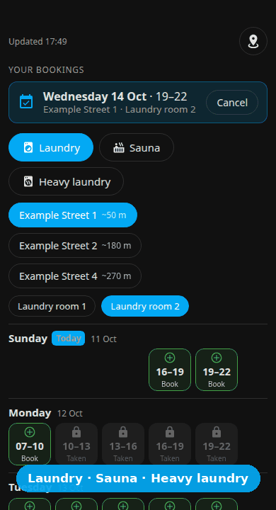
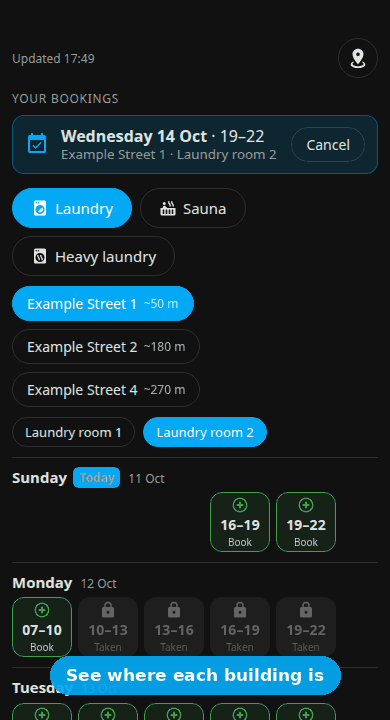
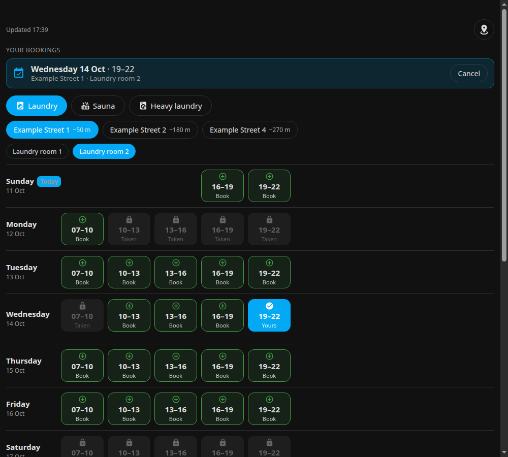

# Amido laundry booking card for Home Assistant

**Book your building's laundry room or sauna with one tap – right from your Home Assistant dashboard.**
Built for tenants whose landlord's portal forwards to an **Amido "KundPortal"** booking system.

<p align="center">
  
</p>

> **⚠️ Unofficial · personal use only.** Not affiliated with any landlord or with Amido. Read
> [DISCLAIMER.md](DISCLAIMER.md) first – you are responsible for following the terms that apply to you.
> *(Svensk sammanfattning längst ner.)*

## Why this instead of the portal's own page?

| The portal | This card |
|---|---|
| Pick an object in a tree → open a calendar → click a tiny cell → answer pop-ups; then wait for the page | **One screen. Tap a time → confirm → done.** |
| 3–8 s before you know whether it worked | **Instant, optimistic UI** – the slot turns "Yours" immediately and rolls back automatically if the portal says no |
| Hard to tell icons apart | **Self-explanatory:** green **+ Book**, blue **✓ Yours**, grey **🔒 Taken** – no legend needed |
| No idea which building is closest | **Nearest building first**, distances, an optional **map** and tap-for-**directions** |
| Open a browser, log in, navigate… | Lives on your **phone-friendly dashboard**, dark/light theme, Swedish & English |
| – | **Polite to the portal:** *no background polling at all*, request spacing, caching, back-off, login circuit-breaker |
| – | **Private & self-hosted:** your login stays in a local `chmod 600` file; no cloud, no telemetry |

## Tour

<table>
<tr>
<td align="center" width="33%"><br><b>Laundry · sauna · heavy laundry</b><br>one tap, nearest building first</td>
<td align="center" width="33%"><br><b>Map &amp; directions</b><br>tap a building number</td>
<td align="center" width="33%"><br><b>Desktop &amp; mobile</b><br>aligned grid, same look everywhere</td>
</tr>
</table>

*(All screenshots and GIFs are made from the [demo page](docs/demo/index.html) with invented data – regenerate them with
[`tools/record_gifs.py`](tools/record_gifs.py).)*

## Features

* One tap to **book / cancel**, with an instant, optimistic UI and automatic rollback if the portal refuses.
* Clear symbols and text – **Book** (green +), **Yours** (blue ✓), **Taken** (grey lock) – no legend needed.
* Filter by **type** (laundry / sauna / heavy laundry), **building** (nearest first) and **room**.
* Optional **map** with distances from your home and a tap-for-**directions** popup.
* Works on phones, supports Swedish and English, follows your Home Assistant theme (light/dark).

## Polite by design (protects the portal and your account)

| Behaviour | How |
|---|---|
| **Nothing runs in the background** | Data is requested only while the card is on screen *and* the browser tab is visible. Closing the page = zero requests. |
| Request spacing | ≥ 1 s between any two requests, enforced across processes with a lock (parallel card requests queue up). |
| Caching | Calendars 2 min, object list 24 h, portal link 30 min. Refresh every 3 min while open (configurable, min 1). |
| Exponential back-off | After a network error / HTTP 429 / 5xx: 30 s, 1 min, 2 min … up to 1 h, with **no** requests during the pause. |
| Login circuit-breaker | A failed login blocks further login attempts for 6 h; max 6 logins/day. It never retries a wrong password. |
| Honest identification | `User-Agent: ha-amido-laundry/x.y (personal use; unofficial; low request rate)` – it does not pretend to be a browser. |
| Only your own data | Only the object you look at is read; nothing is crawled; no other accounts. |

These limits are covered by unit tests (`pytest`). Please do not weaken them.

## Requirements

* Home Assistant (container/OS/Core) where you can run `shell_command` and place files in `/config`.
* Python 3 with `requests` (already present in the official Home Assistant image).
* A tenant login for your landlord's portal that includes the laundry/sauna booking link.

## Install

1. **Copy the files** to your Home Assistant `/config`:
   * `amido_laundry.py` → `/config/amido_laundry.py`
   * `dist/amido-laundry-card.js` → `/config/www/amido-laundry-card.js`
2. **Store your login** (hidden prompts, file is `chmod 600`):
   ```bash
   python3 tools/set_credentials.py /config
   ```
   The password is never printed or logged. *Do not paste it into chat or an issue.*
3. **Add the services** – copy [`packages/amido_laundry.yaml`](packages/amido_laundry.yaml) into your
   configuration (as a package, or merge the `shell_command:` block) and restart Home Assistant.
4. **Add the card resource** (Settings → Dashboards → ⋮ → Resources, or YAML):
   ```yaml
   lovelace:
     resources:
       - url: /local/amido-laundry-card.js?v=1
         type: module
   ```
   (HACS can also install the card file: *Custom repositories → Dashboard*. The Python backend and the
   services in step 3 are still required.)
5. **Add the card** to a dashboard:
   ```yaml
   type: custom:amido-laundry-card
   ```
6. Open the dashboard. The first load logs in (takes ~10 s because requests are spaced out); after that it
   is cached.

## Card options

```yaml
type: custom:amido-laundry-card
language: sv                 # sv (default) | en
default_object: "Building · Room"   # object id, "Building · Room", or part of it; otherwise the last used
refresh_minutes: 3           # while on screen; minimum 1
portal_url: ""               # optional link shown under the card to the landlord's own booking page
home: { lat: 0, lon: 0, name: "Home" }      # optional; defaults to zone.home
map: true                    # needs `locations`
locations:                   # optional: building name exactly as displayed → coordinates
  "Example Street 1": { lat: 59.3270, lon: 18.0690 }
```
See [`docs/example-card.yaml`](docs/example-card.yaml). Without `locations` the card simply hides distances and the map.

## Backend settings (optional)

`/config/amido_laundry.json` – see [`amido_laundry.example.json`](amido_laundry.example.json) and the `DEFAULTS` in
[`amido_laundry.py`](amido_laundry.py). `min_interval` cannot go below 0.5 s.

Other landlords: set `"provider": "manual"` and `"menu_url"` to a `…/KundPortal/BookingMenu.aspx?Apartment=…`
link. Those links expire, so this mode is mainly for experiments; adding a login flow for another portal is a
small function in `amido_laundry.py` (pull requests welcome – keep the polite-client rules).

## Command line (for debugging)

```bash
python3 amido_laundry.py objects
python3 amido_laundry.py calendar 11-12-13
python3 amido_laundry.py mybookings
python3 amido_laundry.py reset          # clears back-off / login block / cache
```
Each command prints one JSON line with `state` and, on errors, a stable `code`
(`blocked`, `auth`, `auth_blocked`, `network`, `stale`, `busy`, `invalid`, `internal`).

## Security & privacy

See [SECURITY.md](SECURITY.md) and the privacy section of [DISCLAIMER.md](DISCLAIMER.md). In short: everything
is local; secrets live in `chmod 600` files; nothing is sent to the authors; all portal text is HTML-escaped;
the card never builds shell commands. The optional map contacts `unpkg.com` and OpenStreetMap (`map: false` turns
it off).

## For AI assistants

If you are an AI assistant helping a user set this up, read [`docs/AI_SETUP.md`](docs/AI_SETUP.md) first.

## Troubleshooting

| Message / code | Meaning |
|---|---|
| `auth` | Login failed or no credentials file. Fix the credentials, then `python3 amido_laundry.py reset`. |
| `auth_blocked` | Logins are paused (6 h) after a failure – by design. Fix the cause, then `reset`. |
| `blocked` | Paused after a network error; resumes by itself (see time in the message). |
| `stale` | The stored portal link expired; the next refresh logs in again (once). |
| Card shows "Could not call Home Assistant" | The `shell_command` services from step 3 are missing. |

## Development

```bash
pip install pytest
pytest            # offline tests with synthetic fixtures – no network, no real data
node --check dist/amido-laundry-card.js
```
Never commit real portal HTML, links, names, addresses or coordinates – fixtures must be synthetic.

## Svenska (kort)

Ett Lovelace-kort för Home Assistant som låter dig **boka tvättstuga och bastu** hos hyresvärdar vars portal
använder **Amido KundPortal**. Tryck på en tid för att boka, tryck på din egen tid för att avboka.
**Inofficiellt och endast för eget bruk** – läs [DISCLAIMER.md](DISCLAIMER.md). Inget körs i bakgrunden: tider
hämtas bara medan kortet är öppet, med fördröjning mellan anrop, cache, backoff och spärr efter misslyckad
inloggning. Du ansvarar själv för att följa de villkor som gäller för dig (hyresavtal, portalens villkor) – fråga
din hyresvärd om du är osäker (mall i DISCLAIMER.md). Installation: se *Install* ovan.

## License

MIT – see [LICENSE](LICENSE).
